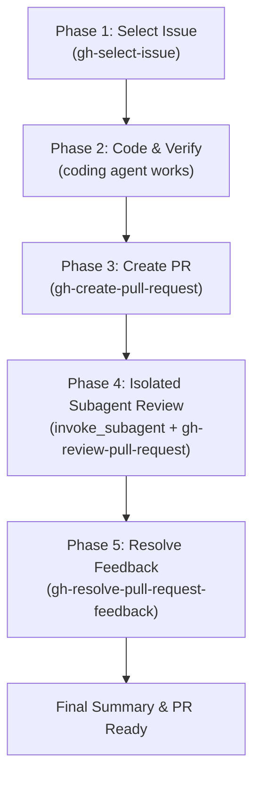

# End-to-End Development Meta Workflow (`gh-develop`)

This meta workflow orchestrates the full software development lifecycle for GitHub repositories by composing existing specialized component skills across five sequential phases:



---

## Context & Bias Isolation

When the primary agent implements a feature, its prompt context carries internal implementation history and design assumptions. To prevent **author confirmation bias**, Phase 4 delegates code review to a **fresh subagent** via `invoke_subagent`. The reviewer subagent operates with an isolated context, evaluating the pull request objectively based strictly on the issue criteria, PR description, and `git diff`.

---

## Execution Principle: Mandatory Skill Loading

Before executing Phase 1, Phase 3, Phase 4, or Phase 5, the executing agent (primary or subagent) **MUST use `view_file` to read the exact component skill file from `~/.agents/skills/<skill-name>/SKILL.md`**. Reading the skill file directly from the installed skills path ensures that repository PR template checks (`.github/PULL_REQUEST_TEMPLATE.md`), test verification procedures, API payloads, and mandatory AI attribution footers are fully loaded and followed without path ambiguity or searching.

---

## Workflow Execution Steps

### 1. Select Issue & Prepare Branch
- **Action**: Use `view_file` to read `~/.agents/skills/gh-select-issue/SKILL.md`.
- Execute all instructions in `gh-select-issue`: interactively select an open issue, view details, and create a feature branch (`feat/issue-<num>-<slug>`).

### 2. Implement & Verify Code
- Analyze issue requirements and target files in codebase.
- Implement code changes and verify with local project test suites.

### 3. Create Pull Request
- **Action**: Use `view_file` to read `~/.agents/skills/gh-create-pull-request/SKILL.md`.
- Execute all instructions in `gh-create-pull-request`: inspect branch diff, check for repository PR templates (`.github/PULL_REQUEST_TEMPLATE.md`), format PR title/body with required sections and attribution footer (`*PR description generated by Antigravity.*`), and submit via `gh pr create`. Store PR number and URL.

### 4. Perform Isolated Subagent PR Review
- **Action**: Launch a subagent via `invoke_subagent` (using `TypeName: "self"` to inherit tool execution access):
  ```json
  {
    "Subagents": [
      {
        "TypeName": "self",
        "Role": "Independent PR Reviewer",
        "Prompt": "Use `view_file` to read `~/.agents/skills/gh-review-pull-request/SKILL.md` and execute a code review for Pull Request #<pr_number> in repository <owner>/<repo> following all workflow instructions in that skill.",
        "Model": "inherit"
      }
    ]
  }
  ```
- Receive review decision and inline comment findings from subagent.

### 5. Address Review Feedback & Finalize
- **Action**: Use `view_file` to read `~/.agents/skills/gh-resolve-pull-request-feedback/SKILL.md`.
- Execute all instructions in `gh-resolve-pull-request-feedback`: fetch unresolved review threads, address code changes, re-verify with tests, post inline replies with required attribution footers via `gh api`, and push updated branch commits.

### 6. Workflow Completion Report
Present a consolidated Markdown report summarizing:
- **Selected Issue**: Issue number, title, and link.
- **Implementation & PR**: Branch name, PR link, and test results.
- **Subagent Review**: Decision (`APPROVE`, `REQUEST_CHANGES`, `COMMENT`) and summary of inline comments.
- **Feedback Resolution**: Addressed threads, inline replies posted, and final PR status.
